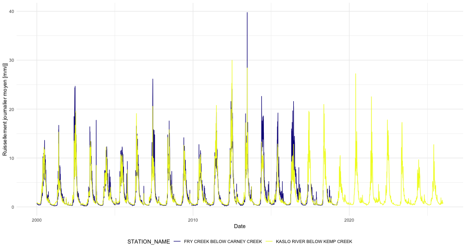

<!--
Translator notes. This is the French version of
tidyhydat_an_introduction.Rmd.orig and should be kept in sync with it. Translate
prose, headings, code comments, and plot labels only; function names, argument
names, column names, and station numbers must remain unchanged. The text follows
Canadian French usage and the typographic conventions of the federal
Translation Bureau: a non-breaking space before colons and inside guillemets,
and no space before semicolons, exclamation marks, or question marks. Prefer the
official ECCC French terminology over literal translations:

  Water Survey of Canada  -> Relevés hydrologiques du Canada
  MSC Datamart            -> Datamart du Service météorologique du Canada
  flow / discharge        -> débit
  water level             -> niveau d'eau
  runoff                  -> ruissellement
  provisional data        -> données provisoires
  validated / approved    -> données approuvées
  real-time               -> temps réel
  web service             -> service Web
  package                 -> package
  HYDAT                   -> HYDAT (unchanged, feminine: la base de données)

Figures use the "vignette-fig-fr-" prefix so that they do not overwrite those
of the English vignette while still matching the pattern in precompile.R.
-->


## Chargement des packages
En plus de tidyhydat, cette vignette utilise le package [dplyr](https://dplyr.tidyverse.org/) pour la manipulation des données et [ggplot2](https://ggplot2.tidyverse.org/) pour les graphiques.

``` r
library(tidyhydat)
library(dplyr)
library(ggplot2)
```

# Le package `tidyhydat`
Cette vignette présente quelques fonctionnalités clés qui vous aideront à tirer parti de `tidyhydat`.

Veuillez noter que les résultats des fonctions de `tidyhydat`, y compris les noms de colonnes comme `STATION_NUMBER`, `Value` et `Approval` ainsi que les résumés affichés à l'écran, sont en anglais, quelle que soit la langue de cette vignette.

## Téléchargement de HYDAT
Pour utiliser bon nombre des fonctions du package `tidyhydat`, vous devez télécharger une version de HYDAT, la base de données hydrométriques historiques d'Environnement et Changement climatique Canada (ECCC), puis indiquer à R où la trouver. Heureusement, `tidyhydat` s'occupe de tout cela pour vous :

``` r
download_hydat()
```
Cette commande télécharge la version la plus récente de HYDAT et l'enregistre à un emplacement de votre ordinateur où les fonctions de `tidyhydat` iront la chercher. Prévoyez du temps, car le téléchargement est long! Pour savoir où HYDAT a été enregistrée, exécutez `hy_dir()`. Une fois HYDAT téléchargée et prête à l'emploi, vous pouvez commencer vos analyses hydrologiques.

## Combinaison des données approuvées et provisoires
Pour la plupart des besoins d'analyse, les fonctions `available_flows()` et `available_levels()` offrent le portrait le plus complet, car elles combinent les données historiques approuvées et les données provisoires récentes en temps réel :


``` r
available_flows(
  station_number = "08MF005",
  start_date = "2020-01-01",
  end_date = Sys.Date()
)
```

Ces fonctions :

- combinent automatiquement les données approuvées de HYDAT (ou du service Web si HYDAT n'est pas disponible) et les données provisoires en temps réel;
- ajoutent une colonne `Approval` qui indique si chaque enregistrement est `"final"` (approuvé) ou `"provisional"` (sujet à révision);
- agrègent les données en temps réel en moyennes journalières par souci de cohérence;
- gèrent adéquatement les données manquantes.

Pour les niveaux d'eau, utilisez `available_levels()` :

``` r
available_levels(
  station_number = "08MF005",
  start_date = "2020-01-01",
  end_date = Sys.Date()
)
```

## Utilisation des fonctions HYDAT
La plupart des fonctions de `tidyhydat` suivent une structure d'arguments commune. Nous utiliserons la fonction `hy_daily_flows()` dans les exemples qui suivent, mais la même approche s'applique à la plupart des fonctions du package (consultez `ls("package:tidyhydat")` pour obtenir la liste des objets exportés). Une grande partie des fonctionnalités de `tidyhydat` repose sur le choix des stations hydrométriques qui vous intéressent. Il est donc fréquent de créer des vecteurs de numéros de station, et il existe plusieurs façons de le faire.

Le cas le plus simple consiste à extraire les données d'une seule station. Vous pouvez fournir son numéro directement à l'argument `station_number` :

``` r
hy_daily_flows(station_number = "08LA001")
```

```
##   Queried from version of HYDAT released on 2026-07-17
##    Observations:                      32,902
##    Measurement flags:                 6,334
##    Parameter(s):                      Flow
##    Date range:                        1914-01-01 to 2026-03-31 
##    Station(s) returned:               1
##    Stations requested but not returned: 
##     All stations returned.
## # A tibble: 32,902 × 5
##    STATION_NUMBER Date       Parameter Value Symbol
##    <chr>          <date>     <chr>     <dbl> <chr> 
##  1 08LA001        1914-01-01 Flow        144 <NA>  
##  2 08LA001        1914-01-02 Flow        144 <NA>  
##  3 08LA001        1914-01-03 Flow        144 <NA>  
##  4 08LA001        1914-01-04 Flow        140 <NA>  
##  5 08LA001        1914-01-05 Flow        140 <NA>  
##  6 08LA001        1914-01-06 Flow        136 <NA>  
##  7 08LA001        1914-01-07 Flow        136 <NA>  
##  8 08LA001        1914-01-08 Flow        140 <NA>  
##  9 08LA001        1914-01-09 Flow        140 <NA>  
## 10 08LA001        1914-01-10 Flow        140 <NA>  
## # ℹ 32,892 more rows
```

Une autre méthode consiste à générer le vecteur avec `hy_stations()`, puis à le passer à l'argument `station_number`. Par exemple, nous pourrions sélectionner uniquement les stations actives de l'Île-du-Prince-Édouard (code de province : PE), puis créer un vecteur pour `hy_daily_flows()` :


``` r
PEI_stns <- hy_stations() |>
  filter(HYD_STATUS == "ACTIVE") |>
  filter(PROV_TERR_STATE_LOC == "PE") |>
  pull_station_number()

PEI_stns
```

```
## [1] "01CA003" "01CB002" "01CB004" "01CB018" "01CC002" "01CC005" "01CC010"
## [8] "01CC011" "01CD005"
```

``` r
hy_daily_flows(station_number = PEI_stns)
```

```
##   Queried from version of HYDAT released on 2026-07-17
##    Observations:                      129,466
##    Measurement flags:                 22,733
##    Parameter(s):                      Flow
##    Date range:                        1961-08-01 to 2025-01-31 
##    Station(s) returned:               9
##    Stations requested but not returned: 
##     All stations returned.
## # A tibble: 129,466 × 5
##    STATION_NUMBER Date       Parameter Value Symbol
##    <chr>          <date>     <chr>     <dbl> <chr> 
##  1 01CA003        1961-08-01 Flow         NA <NA>  
##  2 01CB002        1961-08-01 Flow         NA <NA>  
##  3 01CA003        1961-08-02 Flow         NA <NA>  
##  4 01CB002        1961-08-02 Flow         NA <NA>  
##  5 01CA003        1961-08-03 Flow         NA <NA>  
##  6 01CB002        1961-08-03 Flow         NA <NA>  
##  7 01CA003        1961-08-04 Flow         NA <NA>  
##  8 01CB002        1961-08-04 Flow         NA <NA>  
##  9 01CA003        1961-08-05 Flow         NA <NA>  
## 10 01CB002        1961-08-05 Flow         NA <NA>  
## # ℹ 129,456 more rows
```

Nous pouvons aussi réunir le choix des stations et l'extraction des données dans un seul pipeline qui accomplit une seule tâche. Par exemple, si, pour une raison quelconque, nous voulions toutes les stations du Canada dont le nom contient « Canada », nous pourrions réunir la sélection et l'extraction dans un seul pipeline :

``` r
search_stn_name("canada") |>
  pull_station_number() |>
  hy_daily_flows()
```

```
##   Queried from version of HYDAT released on 2026-07-17
##    Observations:                      93,972
##    Measurement flags:                 28,750
##    Parameter(s):                      Flow
##    Date range:                        1918-08-01 to 2025-12-31 
##    Station(s) returned:               7
##    Stations requested but not returned: 
##     All stations returned.
## # A tibble: 93,972 × 5
##    STATION_NUMBER Date       Parameter Value Symbol
##    <chr>          <date>     <chr>     <dbl> <chr> 
##  1 01AK001        1918-08-01 Flow      NA    <NA>  
##  2 01AK001        1918-08-02 Flow      NA    <NA>  
##  3 01AK001        1918-08-03 Flow      NA    <NA>  
##  4 01AK001        1918-08-04 Flow      NA    <NA>  
##  5 01AK001        1918-08-05 Flow      NA    <NA>  
##  6 01AK001        1918-08-06 Flow      NA    <NA>  
##  7 01AK001        1918-08-07 Flow       1.78 <NA>  
##  8 01AK001        1918-08-08 Flow       1.78 <NA>  
##  9 01AK001        1918-08-09 Flow       1.5  <NA>  
## 10 01AK001        1918-08-10 Flow       1.78 <NA>  
## # ℹ 93,962 more rows
```

Nous avons vu plus haut que, si seule une partie des dates nous intéresse, nous pouvons utiliser les arguments `start_date` et `end_date`. Une date doit être fournie à chacun de ces arguments au format AAAA-MM-JJ. Pour obtenir toutes les données de débit journalier de la station « 08LA001 » pour 1981, vous devez préciser tous les jours de 1981 :

``` r
hy_daily_flows(station_number = "08LA001",
               start_date = "1981-01-01",
               end_date = "1981-12-31")
```

Voilà qui résume l'utilisation des fonctions HYDAT dans `tidyhydat`.

## Fonctions en temps réel
En plus des données approuvées et validées de la base de données HYDAT, ECCC offre des données non approuvées qui sont susceptibles d'être révisées. `tidyhydat` propose trois fonctions pour accéder à ces sources de données. N'oubliez pas qu'il s'agit de données **non approuvées**, qui doivent être traitées comme telles :

- `realtime_stations()`
- `realtime_dd()`
- `realtime_ws()`

Les stations ne font pas toutes partie du réseau en temps réel. C'est pourquoi `realtime_stations()` pointe vers un fichier de données d'ECCC (en principe à jour) qui recense les stations en temps réel actives. Nous pouvons utiliser `realtime_stations()` pour obtenir un vecteur de stations par province ou territoire. Par exemple, nous pouvons sélectionner toutes les stations de l'Île-du-Prince-Édouard comme suit :

``` r
realtime_stations(prov_terr_state_loc = "PE")
```

`hy_stations()` et `realtime_stations()` effectuent des tâches semblables, mais à partir de sources de données différentes. `hy_stations()` extrait l'information directement de HYDAT. En plus des stations en temps réel, `hy_stations()` renvoie les stations fermées et celles qui ne transmettent pas de données en temps réel :

``` r
hy_stations(prov_terr_state_loc = "PE")
```

À l'inverse, `realtime_stations()` télécharge toutes les stations en temps réel. Bien que ce ne soit pas une règle absolue, il est préférable d'utiliser `realtime_stations()` pour les données en temps réel et `hy_stations()` pour travailler avec HYDAT. Il est également pertinent de filtrer le résultat de `hy_stations()` selon la colonne `REAL_TIME`.

### Datamart du Service météorologique du Canada - `realtime_dd()`
Pour télécharger des données en temps réel à partir du Datamart, nous pouvons utiliser à peu près les mêmes conventions que celles décrites plus haut. Avec `realtime_dd()`, il est facile de sélectionner des stations précises en fournissant le numéro de la station qui nous intéresse :

``` r
realtime_dd(station_number = "08LG006")
```
Une autre option consiste à fournir simplement la province en argument pour télécharger toutes les stations de cette province :

``` r
realtime_dd(prov_terr_state_loc = "PE")
```

### Service Web en temps réel - `realtime_ws()`
La fonction `realtime_ws()` donne accès au service Web en temps réel d'ECCC. Celui-ci offre plusieurs avantages, notamment l'accès à une plus grande variété de paramètres et la possibilité de filtrer par plage de dates. Pour utiliser `realtime_ws()`, il faut préciser à la fois la station et le paramètre voulu :

``` r
realtime_ws(station_number = "08MF005",
            parameters = 46, ## Niveau d'eau
            start_date = Sys.Date() - lubridate::days(30),
            end_date = Sys.Date())
```

Vous pouvez interroger plusieurs paramètres à la fois. Consultez `data("param_id")` pour obtenir la liste complète des codes de paramètres disponibles :

``` r
realtime_ws(station_number = "08MF005",
            parameters = c(46, 47), ## Niveau d'eau et débit
            start_date = Sys.Date() - lubridate::days(7),
            end_date = Sys.Date())
```

## Utilisation du service Web sans HYDAT
Pour les petites requêtes qui ne justifient pas le téléchargement de toute la base de données HYDAT, vous pouvez utiliser `hy_daily_flows()` et `hy_daily_levels()` avec `hydat_path = FALSE` pour accéder aux données journalières historiques directement à partir du service Web d'ECCC. Cette option est particulièrement utile lorsque vous n'avez besoin que des données de quelques stations ou d'une période limitée :

### Débits et niveaux historiques au moyen du service Web

``` r
hy_daily_flows(station_number = "08MF005",
               hydat_path = FALSE,
               start_date = "2020-01-01",
               end_date = "2020-12-31")
```

De même, pour les niveaux d'eau :

``` r
hy_daily_levels(station_number = "08NL071",
                hydat_path = FALSE,
                start_date = "2019-01-01",
                end_date = "2019-12-31")
```

Plusieurs stations peuvent être interrogées en un seul appel :

``` r
hy_daily_flows(station_number = c("08MF005", "08NL071"),
               hydat_path = FALSE,
               start_date = "2020-01-01",
               end_date = "2020-12-31")
```

## Fonctions de recherche
Lorsque vous connaissez une partie du nom d'une station, vous pouvez aussi utiliser les fonctions auxiliaires `search_stn_name()` et `search_stn_number()` de `tidyhydat` pour trouver les stations correspondantes. Par exemple :

``` r
search_stn_name("liard")
```

```
## # A tibble: 10 × 5
##    STATION_NUMBER STATION_NAME            PROV_TERR_STATE_LOC LATITUDE LONGITUDE
##    <chr>          <chr>                   <chr>                  <dbl>     <dbl>
##  1 10AA001        LIARD RIVER AT UPPER C… YT                      60.1     -129.
##  2 10AA006        LIARD RIVER BELOW SCUR… YT                      60.8     -131.
##  3 10EC004        SOUTH NAHANNI RIVER NE… NT                      61.0     -123.
##  4 10ED002        LIARD RIVER NEAR THE M… NT                      61.7     -121.
##  5 10BE001        LIARD RIVER AT LOWER C… BC                      59.4     -126.
##  6 10BE005        LIARD RIVER ABOVE BEAV… BC                      59.7     -124.
##  7 10BE006        LIARD RIVER ABOVE KECH… BC                      59.7     -127.
##  8 10ED001        LIARD RIVER AT FORT LI… NT                      60.2     -123.
##  9 10ED008        LIARD RIVER AT LINDBER… NT                      61.1     -123.
## 10 10GC004        MACKENZIE RIVER ABOVE … NT                      61.9     -121.
```
De même, `search_stn_number()` peut être utile si vous vous intéressez à toutes les stations du sous-sous-bassin *08MF* :

``` r
search_stn_number("08MF")
```

```
## # A tibble: 54 × 5
##    STATION_NUMBER STATION_NAME            PROV_TERR_STATE_LOC LATITUDE LONGITUDE
##    <chr>          <chr>                   <chr>                  <dbl>     <dbl>
##  1 08MF005        FRASER RIVER AT HOPE    BC                      49.4     -121.
##  2 08MF040        FRASER RIVER ABOVE TEX… BC                      50.6     -122.
##  3 08MF062        COQUIHALLA RIVER BELOW… BC                      49.5     -121.
##  4 08MF065        NAHATLATCH RIVER BELOW… BC                      50.0     -122.
##  5 08MF068        COQUIHALLA RIVER ABOVE… BC                      49.4     -121.
##  6 08MF001        ANDERSON RIVER NEAR BO… BC                      49.8     -121.
##  7 08MF002        BOULDER CREEK NEAR LAI… BC                      49.3     -122.
##  8 08MF003        COQUIHALLA RIVER NEAR … BC                      49.4     -121.
##  9 08MF004        FRASER RIVER ABOVE THO… BC                      50.2     -122.
## 10 08MF006        WAHLEACH CREEK NEAR LA… BC                      49.3     -122.
## # ℹ 44 more rows
```

## Utilisation des jointures
Il faut parfois utiliser l'information contenue dans deux tables de HYDAT. Dans certains cas, cette information doit être combinée en une seule table au moyen d'une colonne commune. Nous illustrons ici le calcul du ruissellement en joignant la table `hy_stations` à la table `hy_daily_flows` selon la colonne `STATION_NUMBER` :

``` r
stns <- c("08NH130", "08NH005")
runoff_data <- hy_daily_flows(station_number = stns, start_date = "2000-01-01") |>
  left_join(
    hy_stations(station_number = stns) |>
      select(STATION_NUMBER, STATION_NAME, DRAINAGE_AREA_GROSS),
    by = "STATION_NUMBER") |>
  ## conversion en mm/j
  mutate(runoff = Value / DRAINAGE_AREA_GROSS * 86400 / 1e6 * 1e3)


ggplot(runoff_data) +
  geom_line(aes(x = Date, y = runoff, colour = STATION_NAME)) +
  labs(y = "Ruissellement journalier moyen [mm/j]") +
  scale_colour_viridis_d(option = "C") +
  theme_minimal() +
  theme(legend.position = "bottom")
```


Voilà une façon efficace de tirer parti de la variété de tables offertes dans HYDAT.

# Licence

    Copyright 2017 Province of British Columbia

    Licensed under the Apache License, Version 2.0 (the "License");
    you may not use this file except in compliance with the License.
    You may obtain a copy of the License at

       http://www.apache.org/licenses/LICENSE-2.0

    Unless required by applicable law or agreed to in writing, software
    distributed under the License is distributed on an "AS IS" BASIS,
    WITHOUT WARRANTIES OR CONDITIONS OF ANY KIND, either express or implied.
    See the License for the specific language governing permissions and
    limitations under the License.
